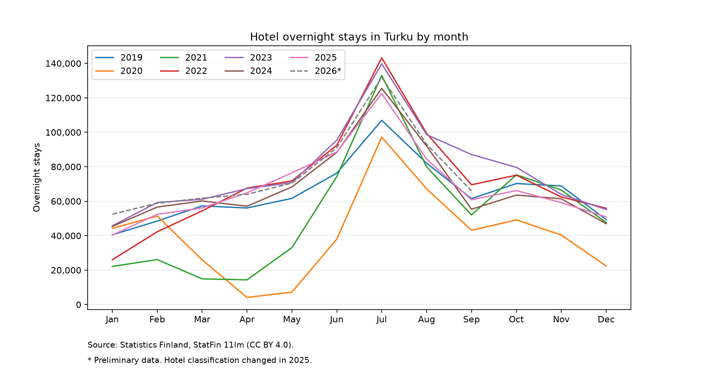
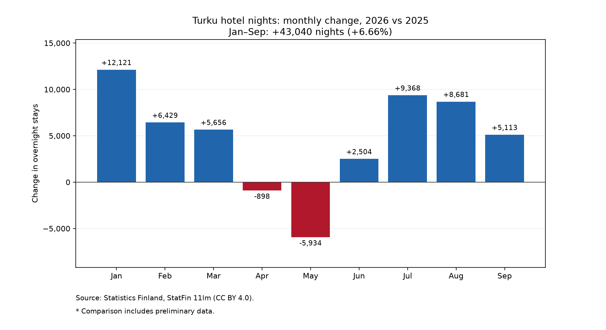
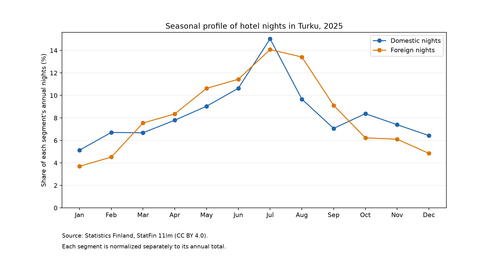

# Turku Tourism Intelligence

[View the dashboard as a 3-page PDF](turku_tourism_dashboard.pdf)

A Data Engineering / Data Analytics portfolio project that turns Statistics Finland open data into validated PostgreSQL models, reproducible SQL analysis and a three-page Power BI report.

**Question:** How have hotel nights in Turku changed relative to Tampere and Oulu, and how much have domestic and international nights contributed to the change?

## Findings

January–September 2026 compared with the same months of 2025:

| City | Hotel nights, 2026 | Change in nights | Growth | International share |
|---|---:|---:|---:|---:|
| Turku | 689,463 | +43,040 | +6.66% | 18.65% |
| Tampere | 1,023,197 | +5,017 | +0.49% | 13.91% |
| Oulu | 449,842 | +53,140 | +13.40% | 17.85% |

Turku grew faster than Tampere and more slowly than Oulu. Domestic and international nights made almost equal contributions to Turku's increase; domestic nights accounted for most of Oulu's increase. These are descriptive results, not estimates of what caused the differences.

In the complete year 2025, June–August accounted for 35.92% of total hotel nights in Turku, compared with 32.09% in Tampere and 29.45% in Oulu. All three peaked in July.

See [city comparison and methodology](reports/city_comparison.md) and [Turku findings](reports/tourism_findings.md).







## Data

Source: [Statistics Finland, StatFin table 11lm](https://pxdata.stat.fi/PXWeb/pxweb/en/StatFin/StatFin__matk/11lm.px), [API endpoint](https://pxdata.stat.fi/PxWeb/api/v1/en/StatFin/matk/11lm.px). Data licence: CC BY 4.0.

The verified snapshot covers January 2019–September 2026: **279 municipality/month rows, 93 months per city**. Municipality codes: Turku `853`, Tampere `837`, Oulu `564`. Source metrics `yopyneet`, `yopyneet_fi` and `yopyneet_ul` provide total, domestic and foreign (international) hotel nights.

Each raw JSON snapshot stores the source URL, retrieval time in UTC, query, table metadata and response. The current CSV is `data/hotel_nights_monthly.csv`. Future refreshes discover published months from API metadata. Missing or suppressed values are rejected rather than replaced with zero.

## Pipeline

```text
StatFin API
  → timestamped raw JSON and validated CSV
  → PostgreSQL: public.hotel_nights_monthly
  → dbt: marts.stg_statfin_hotel_nights
  → dbt: marts.tourism_seasonality
  → dbt: marts.tourism_city_comparison
  → three dbt tests and source reconciliation
  → SQL analysis, three Turku charts and Power BI import
```

The primary key is `(municipality_code, month)`. Loading is transactional. Reprocessing the same snapshot changes zero rows; older snapshots cannot overwrite newer records. PostgreSQL enforces required values, nonnegative counts, first-of-month dates and the identity domestic + international = total.

The CSV contract requires all three cities to have identical, consecutive coverage from January 2019. The mart builder reconciles every key and all three counts against the CSV. Annual totals and monthly annual shares are populated only for complete 12-month years. Prior-year comparisons use exactly the months observed in the selected year; missing baselines produce blank results.

## Stack and local setup

Python 3.14, PostgreSQL 17, Docker Compose, Airflow 3.4.0, dbt Core 1.12.7 / dbt-postgres 1.11.0, matplotlib and Power BI Desktop. Airflow runs in local standalone mode. This is a local portfolio setup, not a production deployment.

From this folder on Windows, with Python 3.14 and Docker Desktop installed:

```powershell
Copy-Item .env.example .env
```

Set `TURKU_POSTGRES_PASSWORD` in `.env` to your own local password. The real `.env`, Power BI cache and generated dbt artefacts are excluded by `.gitignore`.

```powershell
py -3.14 -m pip install -r requirements.txt
docker compose up -d --build
py -3.14 ingestion/refresh_statfin.py
```

PostgreSQL is exposed on `127.0.0.1:5433`; Airflow is available at `http://localhost:8080`. Inside Docker, PostgreSQL is `postgres:5432`. The database and user are both named `turku_bi` and `turku`, respectively. Inspect the local Airflow container output for the standalone login details:

```powershell
docker compose logs airflow
```

The Russian and English repositories are language editions of the same project. Their default ports overlap: run one checkout's Compose stack at a time. The English PBIP can read the existing local `turku_bi` database directly; opening the translated report does not require starting another stack.

For a separate mart build or Python test run:

```powershell
py -3.14 ingestion/build_marts.py
py -3.14 -m unittest discover -s tests -v
```

dbt runs inside the Airflow container in its own environment. `TURKU_POSTGRES_DB` can select an isolated test database; its default is `turku_bi`. Do not point validation fixtures at a working database.

## Airflow

DAG `turku_tourism` contains seven sequential tasks: `extract_statfin` → `check_data_quality` → `load_postgres` → `build_marts` → `plot_seasonality` → `plot_monthly_change` → `plot_segment_seasonality`.

The schedule is daily at **01:20 Europe/Moscow**, cron `20 1 * * *`, with catchup disabled. The computer, Docker and containers must be running; a browser is not required. API failures are retried twice after the first attempt, with a one-minute delay. Data-quality failures are not retried. The test-only parameter `simulate_source_failure` defaults to false.

The pipeline updates PostgreSQL and PNG charts. Power BI import is refreshed separately, and Markdown findings remain dated analytical snapshots.

## Power BI

Open `turku_tourism_dashboard.pbip`; keep its `.Report` and `.SemanticModel` folders alongside it. This English edition uses `en-GB` model culture, English month/city labels and translated captions. Source columns and measure names remain unchanged.

- **01 · Overview:** Turku volume, segment mix, same-period year-on-year change and monthly trend.
- **02 · Seasonality:** complete years only; domestic and international monthly shares and summer concentration.
- **03 · City comparison:** three-city growth, volumes, segment contributions and normalised full-year profiles.

All pages are 1600 × 1000. The first two pages retain a Turku page filter. The third uses all three cities. For selected incomplete 2026, the full-year profile shows 2025 and labels that choice explicitly.

The source is `marts.tourism_seasonality`, imported from `127.0.0.1:5433`, database `turku_bi`. Enter local database credentials when prompted and select **Refresh** after opening: this distribution contains no cached model data. Do not use the old Russian PBIX; it is intentionally omitted here.

See [dashboard guide and check values](reports/powerbi_dashboard.md). English formatting and all three pages have been checked in the final PDF; the two language PDFs use aligned comparison years.

## Verification and boundaries

The original three-city pipeline passed 21 Python tests, three dbt tests and a full manual seven-task Airflow run on 19 November 2026. An isolated empty-database check loaded 279 rows; repeat and stale-snapshot loads changed zero. The Russian report's 31 measures were executed on the local Power BI engine and passed 612 numerical comparisons. Details and the separate English-edition checks are in [verification](reports/verification.md).

The existing containers were used for these checks. A complete cold deployment on a second computer has not been verified. A successful scheduled run was observed for the earlier one-city version; the three-city extension was verified through a manual run. The English sources and PDF are public. No second running Docker deployment was configured.

## Interpretation limits

- Hotel nights are not unique visitors, pedestrian footfall or souvenir sales.
- 2026 values are preliminary and may be revised.
- [Hotel classification changed in 2025](https://stat.fi/en/documentation/changes-in-statistics/cmj86bfdy90vs07uk47jbqm2i), limiting comparability with earlier years. The headline comparison is 2026 versus 2025.
- [Oulu holds the official EU title European Capital of Culture 2026](https://culture.ec.europa.eu/fr/news/two-european-capitals-of-culture-in-2026). Event effects are not estimated.
- This three-city group is not representative of every Finnish city. Differences in hotel capacity, prices, business travel and other factors are not controlled for. Observed nights do not estimate unmet demand.
- No forecasting, causal inference, store-site selection or profitability estimate is claimed.

The original souvenir-shop idea survives as a separate [break-even scenario](reports/optional_store_scenario.md). Its assumptions are not observed sales or footfall. It is not needed to reproduce the hotel-night analysis.

## Language editions

Русская версия: [Turku Tourism Intelligence — русский репозиторий](https://github.com/YaraBykova/turku-tourism-intelligence).

Both editions contain the same data and calculations.
